# Pomodoro

Timer Pomodoro para Android, configurável de ponta a ponta, com fundos que se movem devagar e animações orgânicas.

<p align="center">
  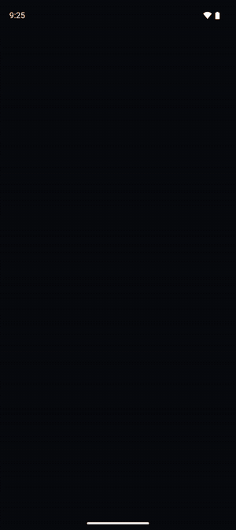
  &nbsp;&nbsp;
  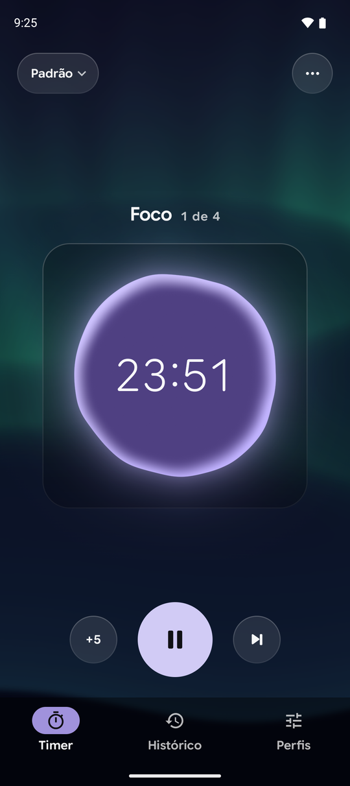
</p>

## O que o app faz

- **Ciclo clássico:** N Focos com Pausas curtas entre eles e uma Pausa longa no fim. As durações, o número de Focos e o início automático são seus.
- **Perfis:** cada Perfil guarda tudo: tempos, som, vibração, botões da notificação, Fundo, Estilo visual e Cor de destaque. Troque de Perfil em um toque.
- **Fundos vivos:** sete artes desenhadas ao vivo com shaders AGSL (Aurora, Dunas, Ondas, Névoa, Seda, Crepúsculo e Nebulosa), Gradiente vivo, cor sólida ou uma foto sua. Um Véu automático mantém o texto legível sobre qualquer Fundo.
- **Cor de destaque:** uma por tipo de Fase, ou tirada do próprio Fundo.
- **Quatro Estilos visuais:** Blob com vidro, Blob puro, Anel fluido e Vidro com parallax.
- **Player na tela de bloqueio:** a Fase aparece como uma música tocando, com barra de progresso, hora do fim e os botões Pausar, +5 min e Pular. Ela não pode ser dispensada enquanto o Ciclo está em andamento.
- **Alerta no fim de cada Fase:** som embutido ou toque do sistema, vibração e, se você quiser, tela cheia sobre a tela bloqueada.
- **Histórico:** barras por dia, semana e mês, mapa de calor do ano, sequência de dias e a lista de Fases, com filtro por Perfil. Os dados ficam só no aparelho.

## Estilos visuais

<p align="center">
  
  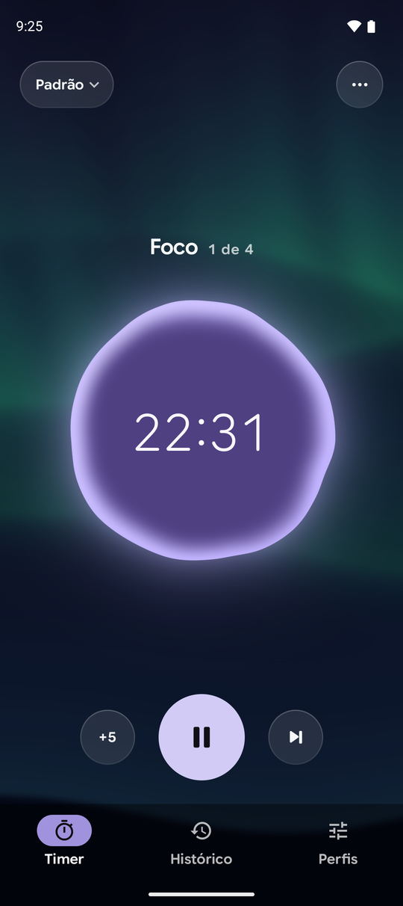
  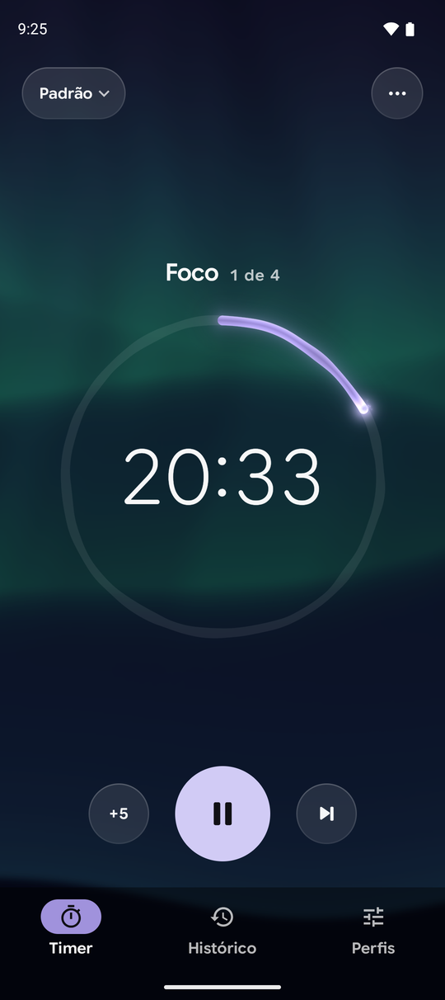
  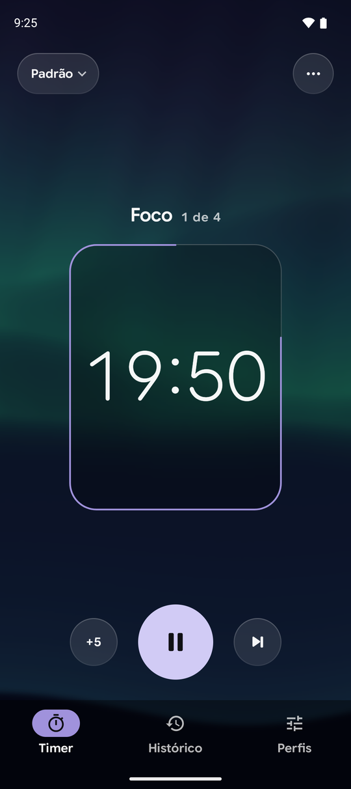
</p>
<p align="center"><sub>Blob com vidro · Blob puro · Anel fluido · Vidro com parallax</sub></p>

## Fundo e Cor de destaque

<p align="center">
  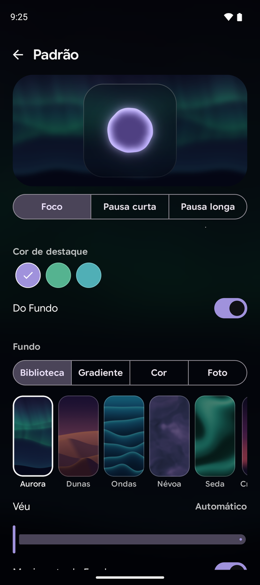
  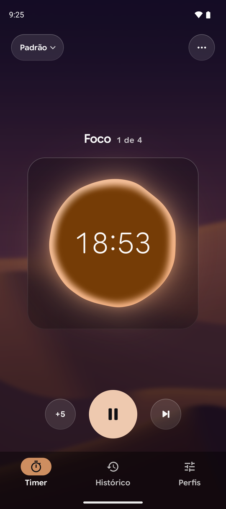
  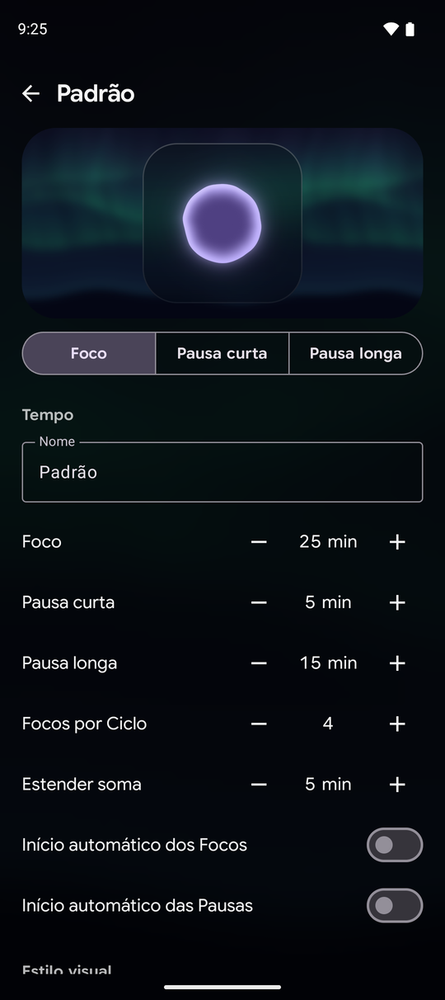
</p>

## Na tela de bloqueio

<p align="center">
  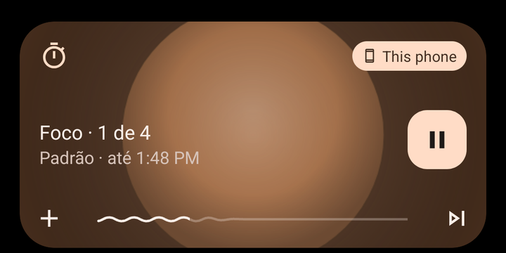
</p>

## Histórico

<p align="center">
  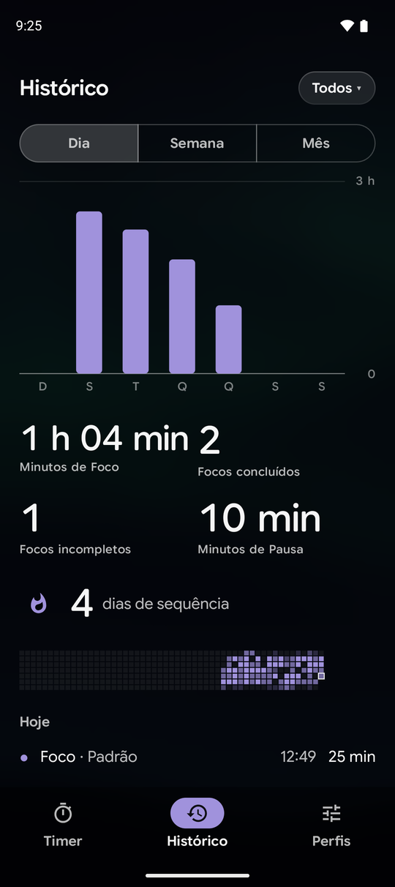
  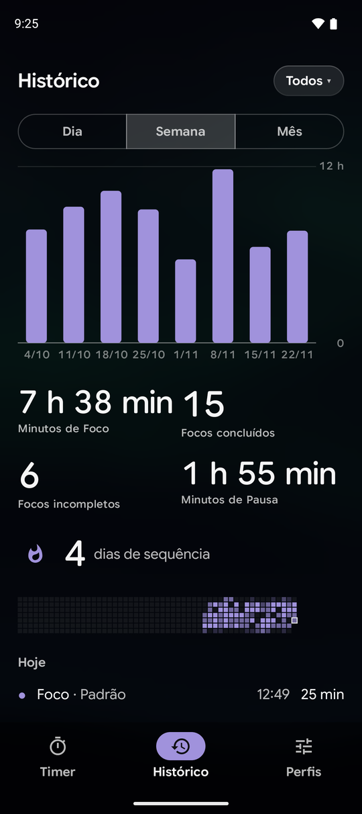
  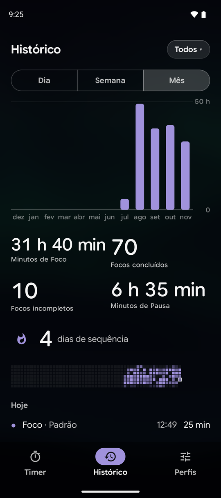
  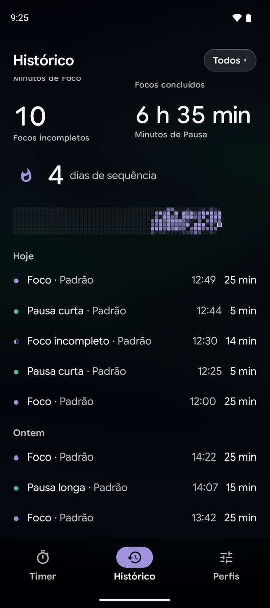
</p>

## Tecnologia

- Kotlin, Jetpack Compose e Material 3. Android 13 ou mais novo ([ADR-0001](docs/adr/0001-android-13-minimo.md)).
- Shaders AGSL para as artes, o blob e o anel, com fallback quando o shader não compila.
- Room e DataStore. Nada sai do aparelho ([ADR-0002](docs/adr/0002-dados-locais-sem-sync.md)).
- Foreground service, alarme exato e `MediaSession` para a contagem em segundo plano e o player da tela de bloqueio.
- O Motor do Ciclo e a agregação do Histórico são Kotlin puro, testados na JVM.

A direção visual e os tokens de movimento estão em [DESIGN.md](DESIGN.md). O vocabulário do domínio está em [GLOSSARY.md](GLOSSARY.md).

## Como compilar

Você precisa do JDK 17 e do Android SDK (compileSdk 36).

```sh
./gradlew testDebugUnitTest   # testes
./gradlew assembleDebug       # APK de debug
```

Para um APK de release assinado, crie um `keystore.properties` na raiz (ele fica fora do git):

```properties
storeFile=../keystore/sua-chave.jks
storePassword=...
keyAlias=...
keyPassword=...
```

Depois rode `./gradlew assembleRelease`. Sem o arquivo, o release sai sem assinatura.

## Créditos

- Fonte [Google Sans Flex](https://fonts.google.com/specimen/Google+Sans+Flex), sob a [SIL Open Font License](app/OFL-google-sans-flex.txt).
- Skills de design de Emil Kowalski em `.claude/skills/`, sob a [licença MIT](.claude/skills/LICENSE-emilkowalski-skills).
